# Andhrimnir Complete Diagrams Document

Andhrimnir - Complete Architecture & Design Diagrams

Mermaid-compatible diagrams for the project.

## System Architecture

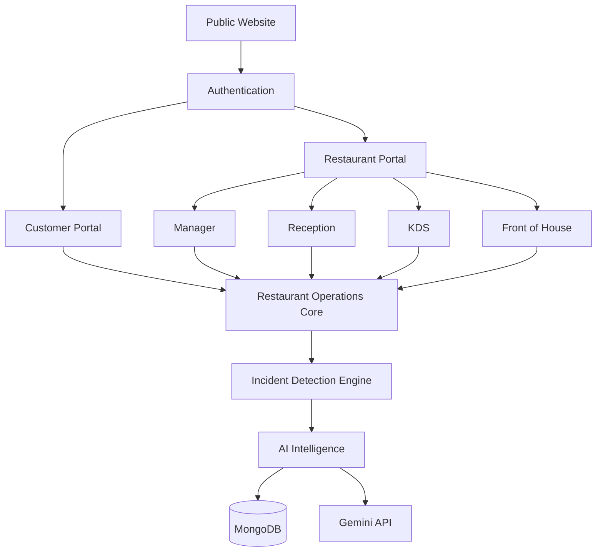

## Application Flow

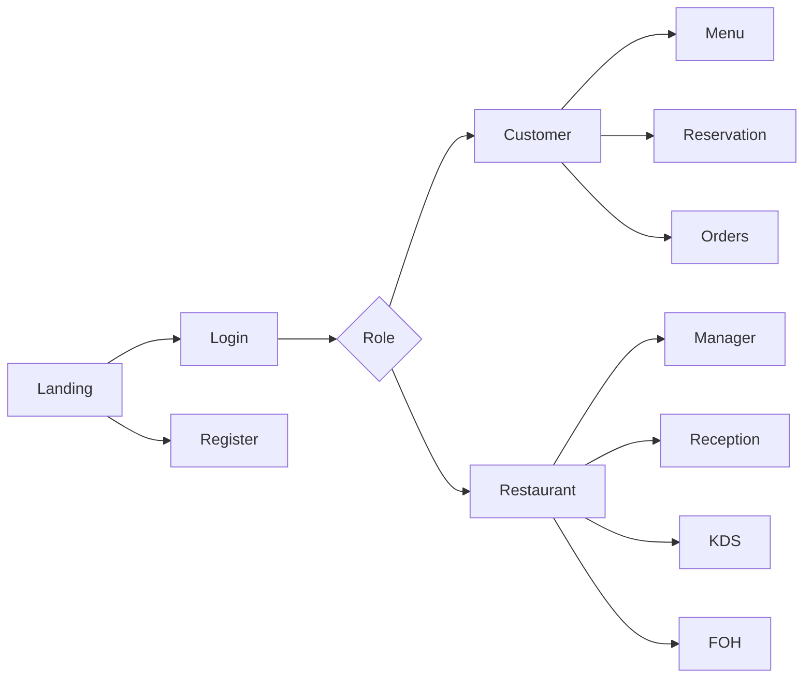

## Data Flow

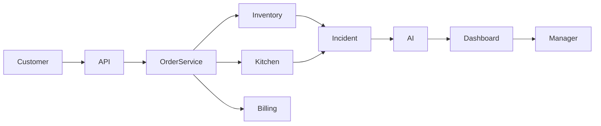

## User Journey

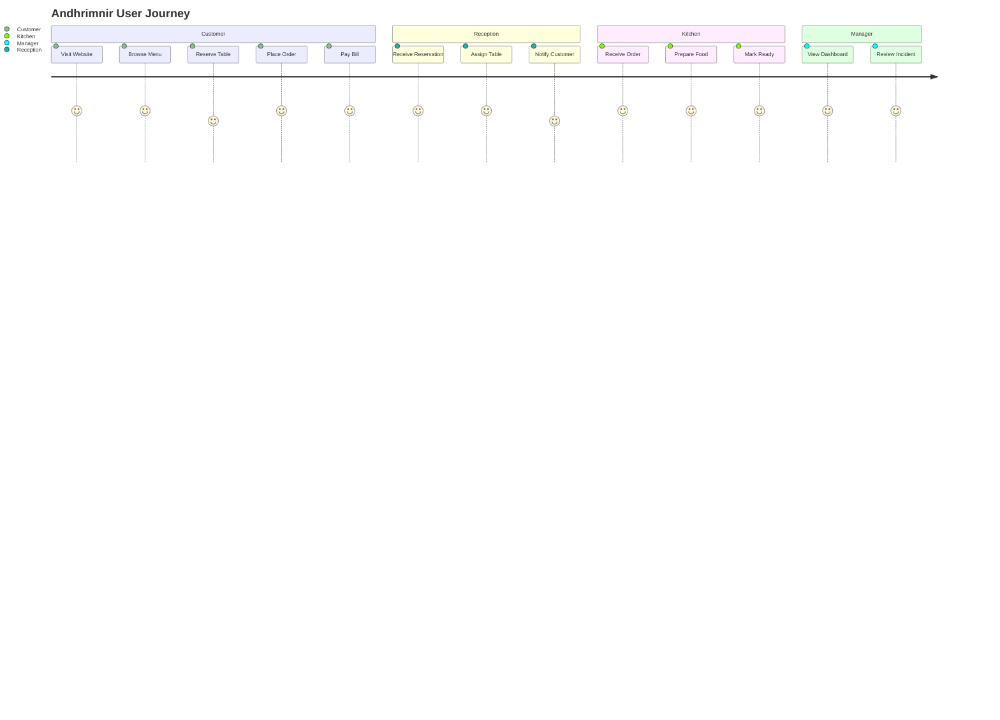

## ER Diagram

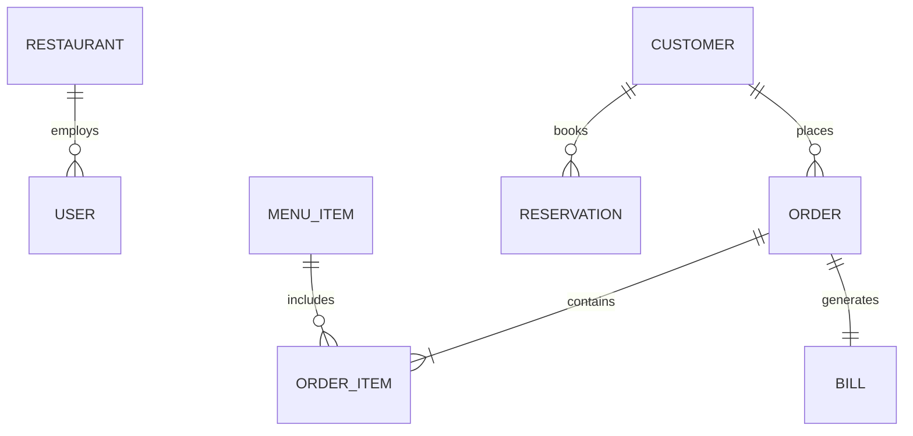

## Deployment

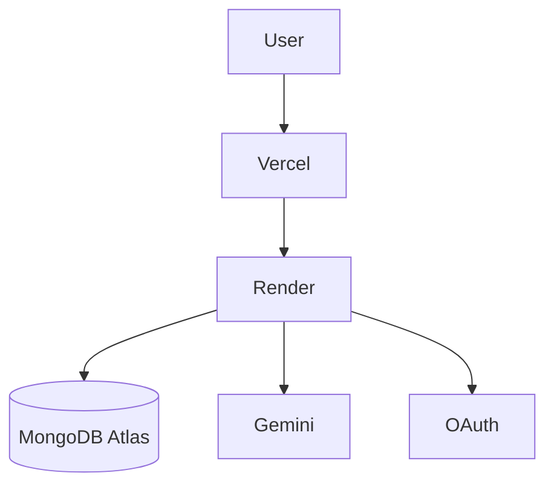

## Incident Detection

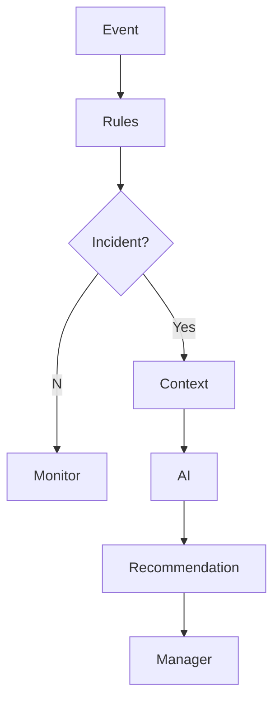

## Sequence

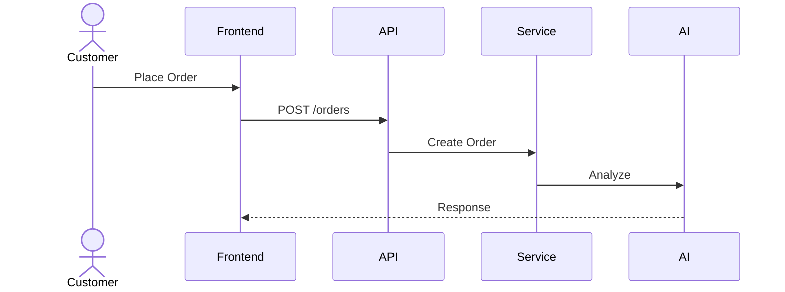

## Component

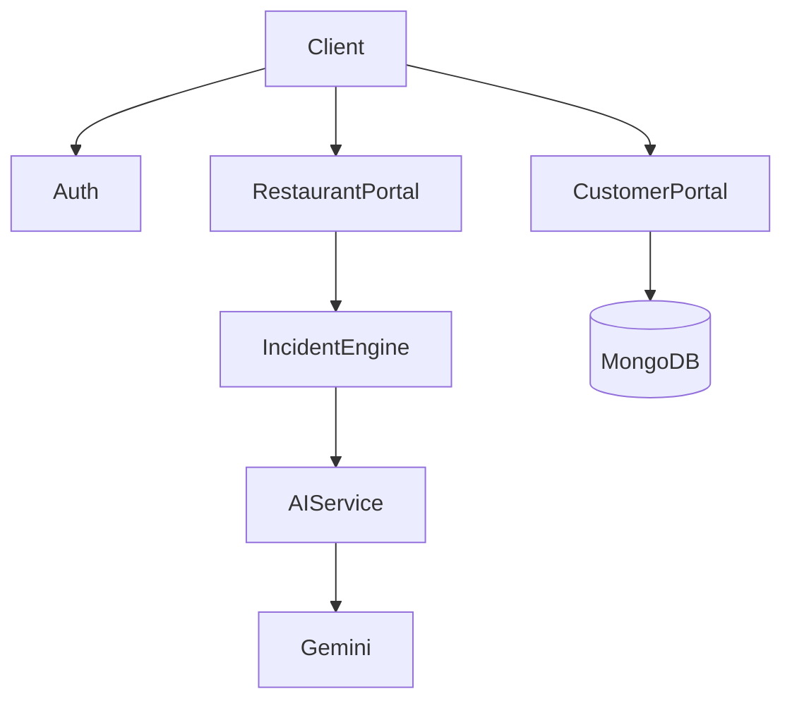

## State

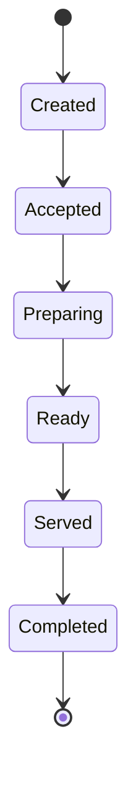

## Activity

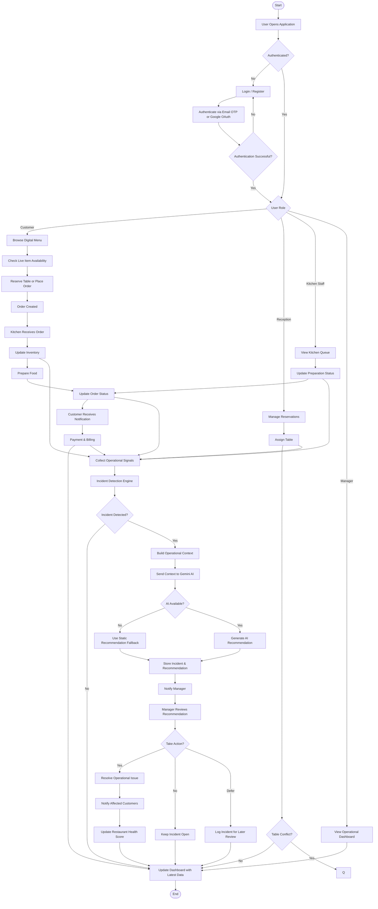

## Security Flow

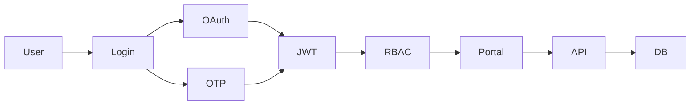

## Scalability

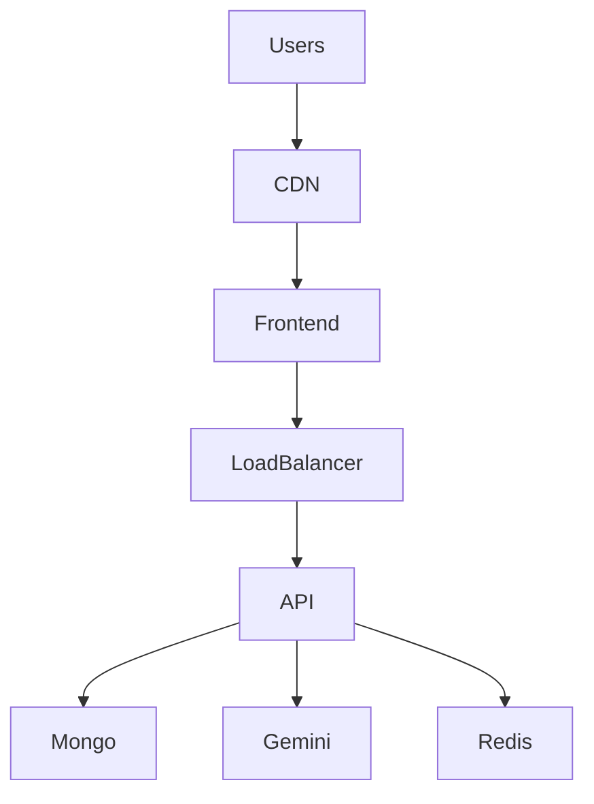
