# Andhrímnir Complete Diagrams Document

Andhrímnir - Complete Architecture & Design Diagrams

Mermaid-compatible diagrams for the project.

## System Architecture

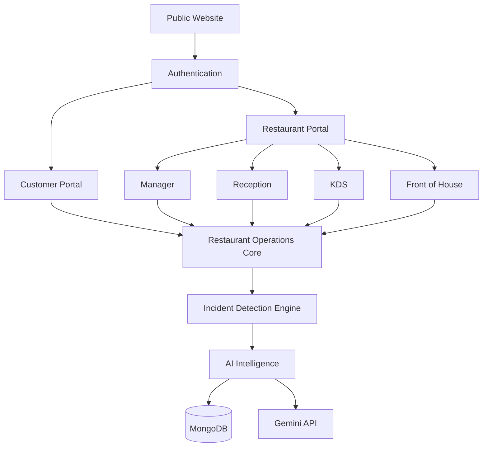

## Application Flow

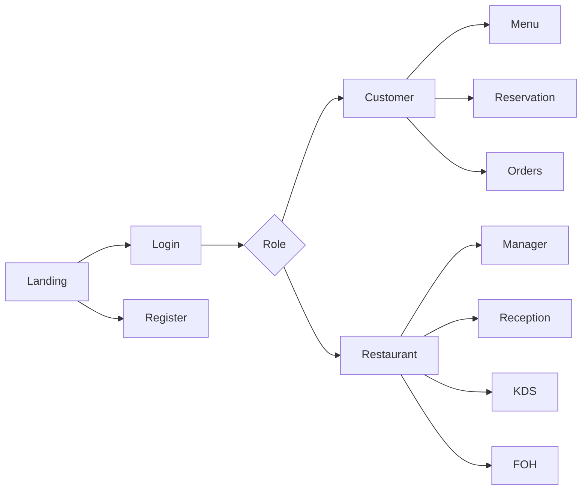

## Data Flow

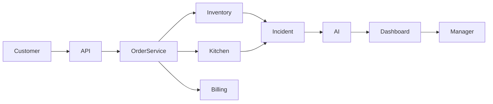

## User Journey

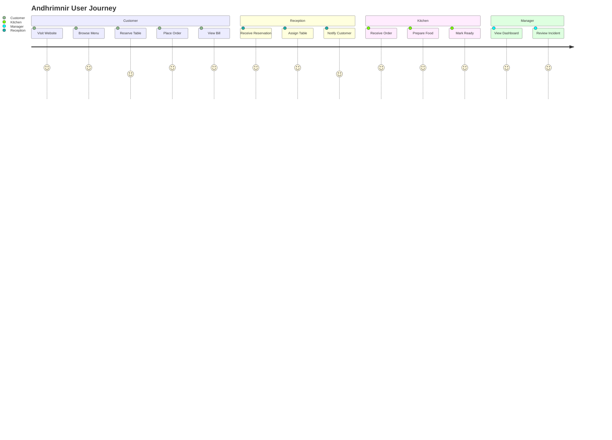

## ER Diagram

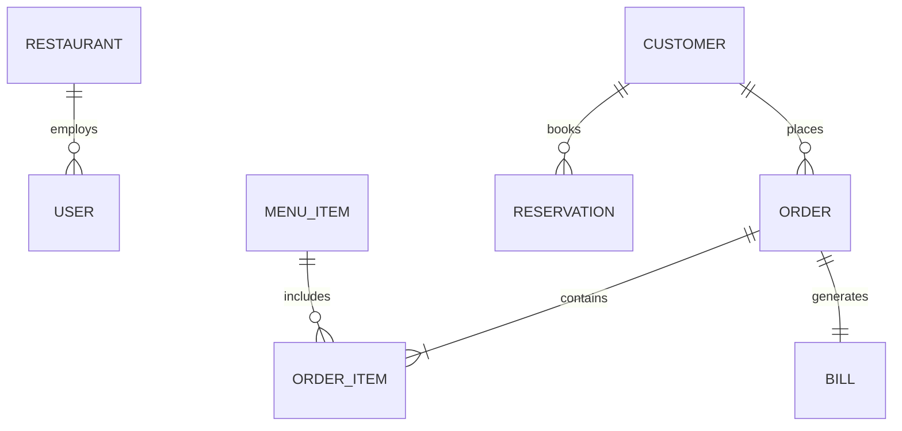

## Deployment

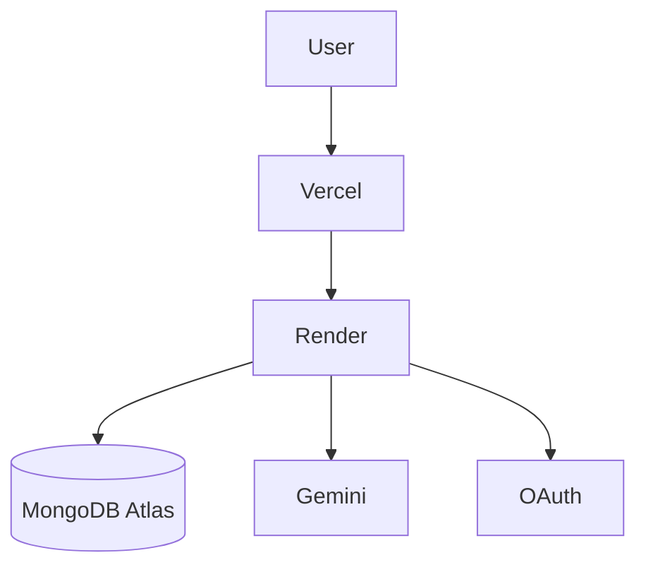

## Incident Detection

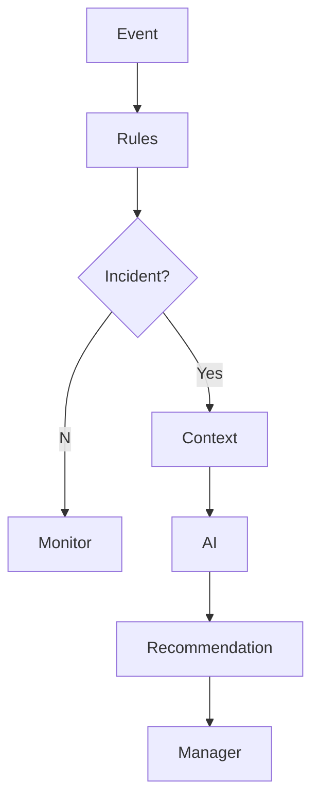

## Sequence

```mermaid
sequenceDiagram
actor Customer
participant Frontend
participant API
participant OrderService
participant MongoDB
Customer->>Frontend: Choose live menu items and quantities
Frontend->>API: POST /api/v1/orders
API->>OrderService: Validate customer, restaurant, and cart
OrderService->>MongoDB: Recheck availability and authoritative prices
OrderService->>MongoDB: Insert item snapshots, then visible order header
MongoDB-->>OrderService: Persisted order with server-calculated subtotal
OrderService-->>API: Order status Created
API-->>Frontend: 201 { order }
Frontend-->>Customer: Show order request; payment/acceptance pending
```

## Component

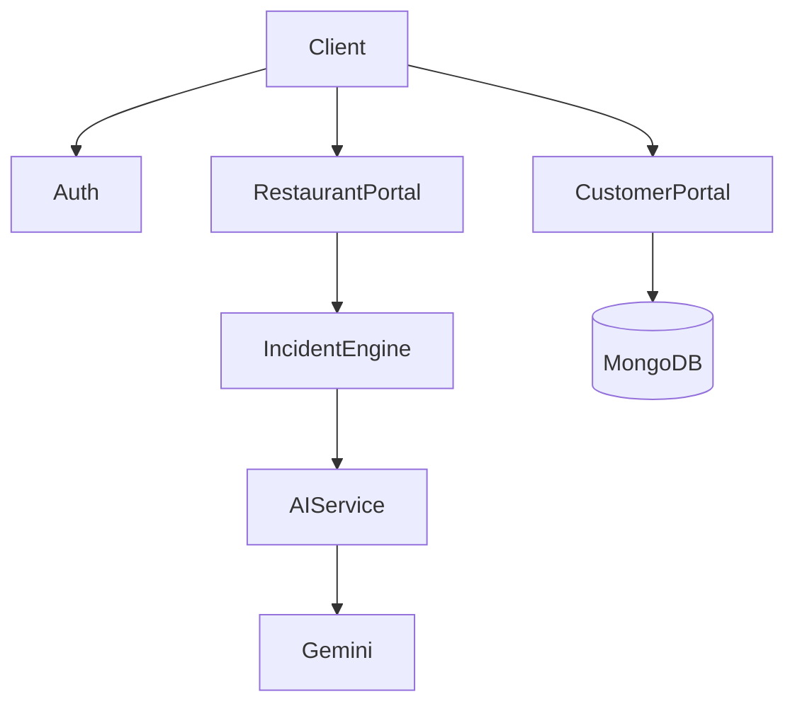

## State

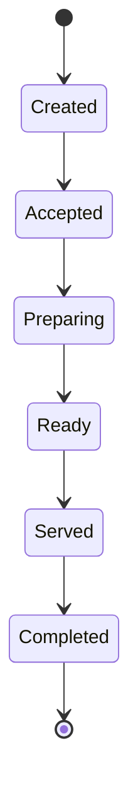

## Reservation Lifecycle

The statuses a booking moves through (S5-01). Staff drive every transition except the guest's own cancellation, which closes at the restaurant's change cutoff. Seating needs a table; a no-show can only be recorded after the grace period. Confirmations, staff changes and cancellations notify the guest (S5-04).

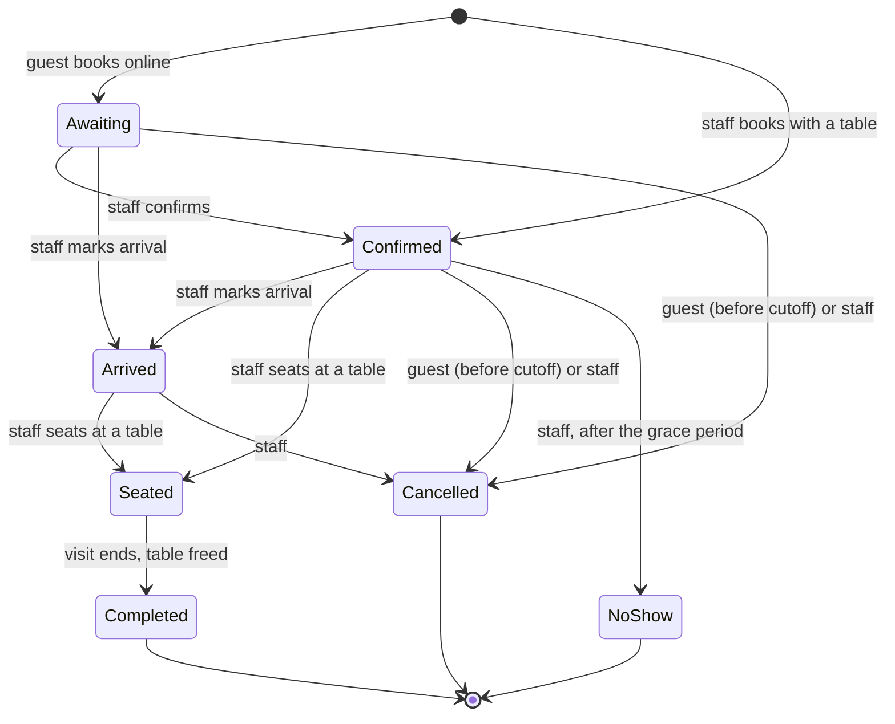

## Activity

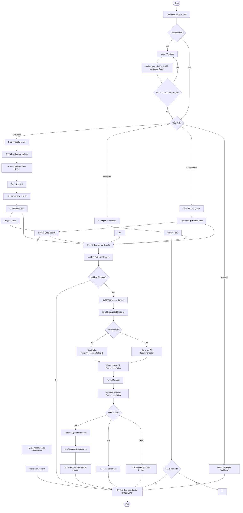

## Security Flow

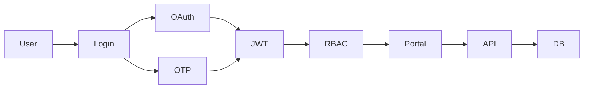

## Scalability

The planned deployment is one Next.js app on Vercel and one API instance on Render, with MongoDB Atlas and the Gemini API. The browser opens the WebSocket to the API directly. Dashed items are possible future additions and do not exist in the code: rate-limit counters and the realtime hub are in-process today, so a second API instance would need a shared store (for example Redis) first.

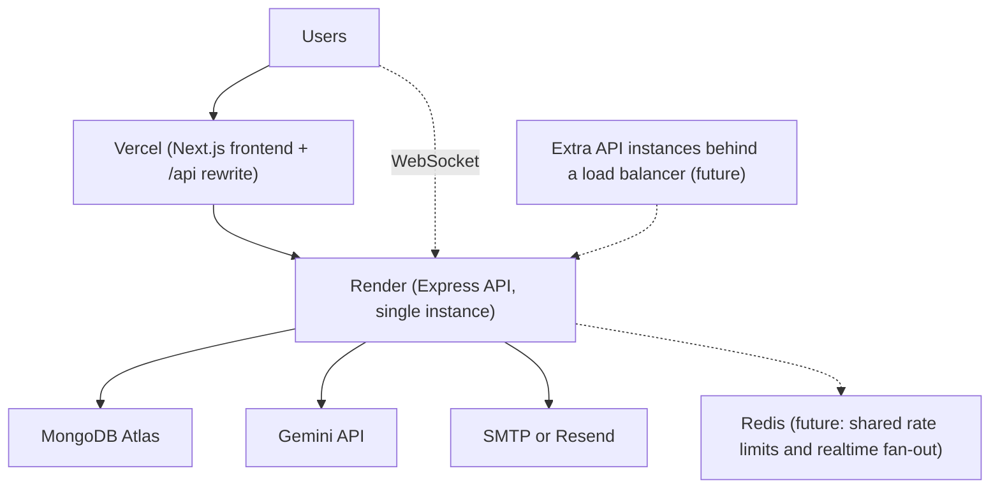
